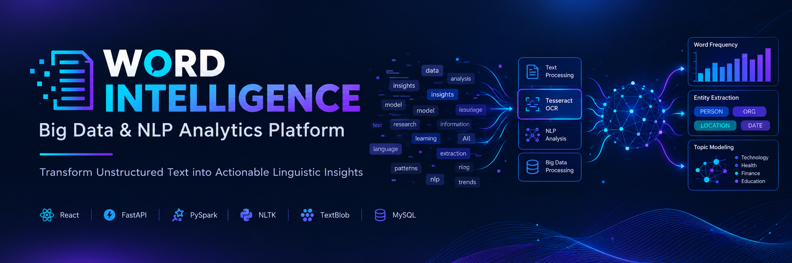
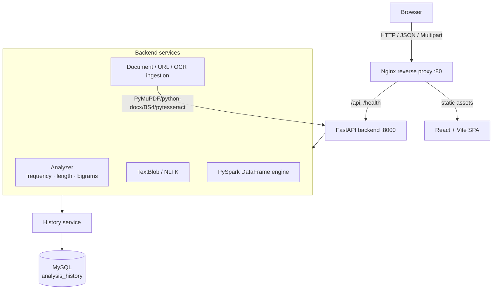

<div align="center">

  

  # 📊 Word Intelligence
  ### *Multi-Source Text Analytics, PySpark Computation, NLP & OCR Platform*

  <p align="center">
    <b>Word Intelligence is a full-stack text-analytics platform that turns raw text, documents, web pages, and images into structured linguistic insight — word frequencies, length distributions, bigrams, noun phrases, and sentiment — with an interactive React dashboard, dual Python/PySpark compute engines, Tesseract OCR, and MySQL-backed history.</b>
  </p>

  <p align="center">
    
    
    
    
  </p>

  <p align="center">
    
    
    
    
    
    
  </p>

</div>

---

## Table of Contents

  - [✨ Overview \& Key Features](#-overview--key-features)
  - [🧱 Technology Stack](#-technology-stack)
  - [🏗️ Architecture](#️-architecture)
  - [📁 Project Structure](#-project-structure)
  - [✅ Prerequisites](#-prerequisites)
  - [🚀 Installation \& Running](#-installation--running)
    - [Option A — Docker Compose (recommended)](#option-a--docker-compose-recommended)
    - [Option B — Local development](#option-b--local-development)
    - [Enabling live OCR on Windows (local dev only)](#enabling-live-ocr-on-windows-local-dev-only)
  - [⚙️ Environment Configuration](#️-environment-configuration)
  - [🔌 API Endpoints](#-api-endpoints)
  - [🧪 Testing](#-testing)
  - [🔒 Security Considerations](#-security-considerations)
  - [⚠️ Known Limitations](#️-known-limitations)
  - [📄 License](#-license)

---

## ✨ Overview & Key Features

Word Intelligence ingests content from four sources and runs a shared analytics pipeline:

| Input source     | Accepted formats                 | Entry point    |
| ---------------- | -------------------------------- | -------------- |
| **Raw text**     | plain text                       | Analyze page   |
| **Documents**    | `.txt`, `.pdf`, `.docx`          | Documents page |
| **Web pages**    | public HTTP/HTTPS URLs           | URL page       |
| **Images (OCR)** | `.png`, `.jpg`, `.jpeg`, `.webp` | Images page    |

For any input it produces:

- **Token metrics** — total tokens, unique tokens, average word length.
- **Word frequency** — ranked counts with percentage share.
- **Word-length distribution** — bucketed histogram.
- **Bigrams** — adjacent two-word collocations with counts.
- **NLP insights** — sentiment polarity/subjectivity (TextBlob) and noun-phrase extraction (NLTK).
- **CSV export** — RFC 4180 report of the current analysis.

Other capabilities:

- **Two engines** — in-memory **Python** (fast) or distributed **Apache PySpark** DataFrame, selectable per run. Both produce identical results.
- **Interactive dashboard** — Chart.js bar/area visualizations with table ⇄ chart toggles and searchable, sortable frequency tables.
- **Persistent history** — runs are saved to **MySQL** and can be searched, filtered, and replayed.
- **Containerized deployment** — multi-stage Docker images with an Nginx reverse proxy.

---

## 🧱 Technology Stack

| Layer               | Components                                                                                                    |
| ------------------- | ------------------------------------------------------------------------------------------------------------- |
| **Frontend**        | React 18.3, React Router v7, Vite 5, Chart.js + react-chartjs-2, Lucide React icons, custom CSS design system |
| **Backend API**     | FastAPI (Uvicorn ASGI), Pydantic v2 + pydantic-settings, Starlette middleware                                 |
| **Big-data engine** | Apache PySpark 4.x (local DataFrame pipeline) on a Java runtime                                               |
| **NLP & parsing**   | TextBlob, NLTK, `pypdf`, `python-docx`, `beautifulsoup4`                                                      |
| **OCR**             | Pillow + `pytesseract` (Tesseract engine)                                                                     |
| **Persistence**     | MySQL 8.4, SQLAlchemy 2.0, Alembic migrations                                                                 |
| **Deployment**      | Multi-stage Docker builds, Nginx reverse proxy, Docker Compose                                                |
| **Testing**         | pytest                                                                                                        |

---

## 🏗️ Architecture

The application is a decoupled, layered stack. In production, Nginx serves the built React bundle and reverse-proxies `/api` and `/health` to the FastAPI backend, which fans out to analytics, ingestion, OCR, and NLP services before persisting to MySQL.



*Equivalent ASCII diagram and deeper detail are maintained in [ARCHITECTURE.md](ARCHITECTURE.md).*

---

## 📁 Project Structure

```text
Word-Count-Analyzer/
├── assets/                     # README banner (banner.png)
├── backend/                    # FastAPI application
│   ├── alembic/                #   DB migrations (analysis_history table)
│   ├── app/
│   │   ├── api/routes/         #   analysis, export, health, history, readiness
│   │   ├── core/               #   config.py, security.py (rate limiter, headers)
│   │   ├── db/                 #   session management & connectivity probe
│   │   ├── models/             #   SQLAlchemy ORM (AnalysisHistory)
│   │   ├── schemas/            #   Pydantic request/response models
│   │   ├── services/           #   analyzer, document, url, ocr, nlp, spark, history, export
│   │   └── main.py             #   application factory + middleware
│   ├── tests/                  #   pytest suite (11 modules, 59 tests)
│   ├── Dockerfile              #   Python 3.13 + OpenJDK + Tesseract runtime
│   ├── entrypoint.sh           #   DB wait → alembic migrate → uvicorn
│   ├── requirements.txt
│   └── requirements-dev.txt
├── frontend/                   # React + Vite SPA
│   ├── src/
│   │   ├── components/         #   charts, tables, results, layout/
│   │   ├── hooks/              #   useAnalysis, useHealth
│   │   ├── pages/              #   Dashboard, Analyze, Documents, Images, URL, History, Settings, 404
│   │   ├── services/api.js     #   HTTP client
│   │   └── styles/index.css    #   design system
│   ├── Dockerfile              #   multi-stage Node build → Nginx
│   ├── nginx.conf              #   reverse proxy config
│   └── package.json
├── docker-compose.yml          #   mysql + backend + frontend orchestration
├── .env.example                #   configuration template
├── ARCHITECTURE.md · PROJECT_CONTEXT.md · TASKS.md
└── README.md
```

---

## ✅ Prerequisites

**For Docker (recommended):**
- Docker Engine + Docker Compose v2

**For local development:**
- **Python 3.13+**
- **Node.js 20+** and npm
- **Java 17+ or 21 LTS** (required only to run the PySpark engine)
- **MySQL 8.0+** reachable on port `3306` (required for history persistence)
- **Tesseract OCR** *(optional for local dev)* — only needed for live image OCR. The Docker backend image bundles it automatically.

---

## 🚀 Installation & Running

### Option A — Docker Compose (recommended)

This starts MySQL, the FastAPI backend, and the React/Nginx frontend together.

```bash
# 1. Enter the repository
cd Word-Count-Analyzer

# 2. Create your environment file
cp .env.example .env

# 3. Build and launch
docker compose up --build -d
```

| What         | URL                               |
| ------------ | --------------------------------- |
| Web UI       | http://localhost                  |
| Swagger docs | http://localhost/api/v1/docs      |
| Health       | http://localhost/health           |
| Readiness    | http://localhost/api/v1/readiness |

Stop with:

```bash
docker compose down          # keeps the MySQL volume
docker compose down -v       # also removes the database volume
```

### Option B — Local development

**1. Configure environment** — copy the template and set your MySQL credentials:

```bash
cp .env.example .env
```

```ini
ENVIRONMENT=development
MYSQL_SERVER=localhost
MYSQL_PORT=3306
MYSQL_USER=root
MYSQL_PASSWORD=your_password
MYSQL_DB=word_intelligence
SQLALCHEMY_DATABASE_URI=mysql+pymysql://${MYSQL_USER}:${MYSQL_PASSWORD}@${MYSQL_SERVER}:${MYSQL_PORT}/${MYSQL_DB}
```

**2. Apply database migrations** (creates the `analysis_history` table):

```bash
python -m alembic upgrade head
```

**3. Run the backend** (from the repository root):

```bash
pip install -r backend/requirements-dev.txt
python -m uvicorn app.main:app --app-dir backend --host 127.0.0.1 --port 8000 --reload
```

- Swagger UI → http://127.0.0.1:8000/api/v1/docs
- Health → http://127.0.0.1:8000/health

**4. Run the frontend** (separate terminal):

```bash
npm --prefix frontend install
npm --prefix frontend run dev
```

Open http://localhost:5173 — Vite proxies `/api` and `/health` to the backend on port 8000.

> **Note:** If MySQL is not running, the app still works. History persistence is optional and degrades gracefully — analyses are returned normally, and history endpoints report a `degraded` readiness status rather than failing.

### Enabling live OCR on Windows (local dev only)

```powershell
winget install --id UB-Mannheim.TesseractOCR --exact
```

The OCR service auto-discovers `C:\Program Files\Tesseract-OCR\tesseract.exe`. To use another location, set `TESSERACT_CMD` in `.env`. When no binary is present, `/api/v1/analysis/image` returns a clear `503`.

---

## ⚙️ Environment Configuration

Key settings (defined in [backend/app/core/config.py](backend/app/core/config.py), overridable via `.env`):

| Variable                                                                     | Default                                                         | Purpose                                     |
| ---------------------------------------------------------------------------- | --------------------------------------------------------------- | ------------------------------------------- |
| `ENVIRONMENT`                                                                | `development`                                                   | Runtime mode                                |
| `BACKEND_HOST` / `BACKEND_PORT`                                              | `127.0.0.1` / `8000`                                            | Bind address for Uvicorn                    |
| `BACKEND_CORS_ORIGINS`                                                       | localhost dev origins                                           | Allowed CORS origins                        |
| `MYSQL_SERVER` / `MYSQL_PORT` / `MYSQL_USER` / `MYSQL_PASSWORD` / `MYSQL_DB` | `localhost` / `3306` / `root` / *(empty)* / `word_intelligence` | MySQL connection                            |
| `SQLALCHEMY_DATABASE_URI`                                                    | *(derived)*                                                     | Full DB URI; falls back to the fields above |
| `ENABLE_DATABASE_HISTORY`                                                    | `true`                                                          | Toggle persisting runs to MySQL             |
| `MAX_UPLOAD_SIZE_BYTES`                                                      | `10485760` (10 MB)                                              | Upload ceiling (docs & images)              |
| `MAX_TEXT_LENGTH_CHARS`                                                      | `500000`                                                        | Max analyzable text length                  |
| `HTTP_REQUEST_TIMEOUT_SECONDS`                                               | `10`                                                            | URL-fetch timeout                           |
| `MAX_IMAGE_PIXELS`                                                           | `25000000`                                                      | Decompression-bomb guard for OCR            |
| `OCR_TIMEOUT_SECONDS`                                                        | `20`                                                            | Per-image OCR processing timeout            |
| `TESSERACT_CMD`                                                              | *(auto-discovered)*                                             | Explicit Tesseract binary path              |
| `ENABLE_SPARK_ANALYTICS`                                                     | `true`                                                          | Expose the PySpark engine                   |
| `SPARK_MASTER` / `SPARK_DRIVER_MEMORY`                                       | `local[2]` / `1g`                                               | Local Spark config                          |
| `RATE_LIMIT_ENABLED` / `RATE_LIMIT_REQUESTS_PER_MINUTE`                      | `true` / `120`                                                  | Compute-endpoint throttling                 |

---

## 🔌 API Endpoints

All API routes are prefixed with **`/api/v1`**. Interactive docs: **`GET /api/v1/docs`** · ReDoc: **`/api/v1/redoc`** · OpenAPI schema: **`/api/v1/openapi.json`**.

| Method   | Path              | Description                                                             |
| -------- | ----------------- | ----------------------------------------------------------------------- |
| `GET`    | `/health`         | Liveness probe (also available at the root path)                        |
| `GET`    | `/readiness`      | Dependency status (MySQL, Spark) without failing liveness               |
| `POST`   | `/analysis`       | Analyze raw text                                                        |
| `POST`   | `/analysis/file`  | Extract & analyze `.txt` / `.pdf` / `.docx` (multipart)                 |
| `POST`   | `/analysis/url`   | Fetch and analyze a public web page (SSRF-safe)                         |
| `POST`   | `/analysis/image` | OCR-extract text from an image and analyze it (multipart)               |
| `POST`   | `/export/csv`     | Export an analysis result as a CSV report                               |
| `GET`    | `/history`        | List past runs (pagination, filters: `source_type`, `engine`, `search`) |
| `GET`    | `/history/stats`  | Aggregate counts (total runs, words analyzed, latest run)               |
| `GET`    | `/history/{id}`   | Full stored payload for replay                                          |
| `DELETE` | `/history/{id}`   | Delete a stored run                                                     |

---

## 🧪 Testing

**Backend** — from the repository root:

```bash
python -m pytest -s backend/tests
```

The suite spans 11 modules (`test_analysis`, `test_documents`, `test_urls`, `test_nlp`, `test_ocr`, `test_spark`, `test_export`, `test_history`, `test_security`, `test_health`, `benchmark_spark`). **59 tests were passing** at the time of writing.

> Some history/readiness tests exercise real MySQL connectivity via `check_db_connectivity()`. Run them against a live, migrated database (or the Docker stack) for accurate results; they may be skipped or fail if no database is reachable.

**Frontend** — verify the production build:

```bash
npm --prefix frontend run build
```

---

## 🔒 Security Considerations

Implemented and verified in [backend/app/core/security.py](backend/app/core/security.py) and the ingestion services:

- **SSRF defense** (URL ingestion) — blocks loopback, private/link-local/multicast/reserved IPv4 & IPv6, IPv4-mapped IPv6, and obfuscated integer/hex hosts; validates DNS before connecting and re-validates after each redirect (max 5); enforces timeouts and byte limits.
- **Upload safety** — size caps, extension + content verification, image **dimension / decompression-bomb** limits, and corrupted-file rejection.
- **Filename sanitization** — strips directory traversal (`../`), null bytes, and control characters; bounds length.
- **CSV formula-injection mitigation** — prefixes dangerous cells (`=`, `+`, `-`, `@`, tab/CR) per CWE-1236.
- **Security headers** — `X-Content-Type-Options`, `X-Frame-Options: DENY`, `X-XSS-Protection`, `Referrer-Policy`, `Permissions-Policy`, and a restrictive `Content-Security-Policy`.
- **Rate limiting** — sliding-window throttle on compute-heavy endpoints (`/analysis*`, `/export*`) returning `429` + `Retry-After`; health/readiness probes are exempt.
- **CORS** — explicit origin allow-list from configuration.

---

## ⚠️ Known Limitations

- **PySpark runs locally** (`local[2]`) — the DataFrame engine is demonstrated on a single node, not a distributed cluster.
- **OCR quality** — optimized for high-contrast printed text; handwriting and complex multi-column layouts are not guaranteed.
- **Local OCR requires Tesseract** — on non-Docker setups the binary must be installed separately (auto-installed in the Docker image).
- **History depends on MySQL** — a running, migrated database is required for persistence and the history endpoints.
- **No screenshots in this README** yet (see above).
- **No CI/CD pipeline** — tests are run manually via `pytest`.

---

## 📄 License

Distributed under the **MIT License** — see [LICENSE](LICENSE).

Copyright © 2025 Aakash G
